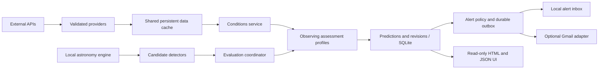

# All Sky Alert architecture

Initial design recorded before implementation, 2026-10-06; extension reviewed
2026-10-08 in [Phase 2 design](phase2-architecture.md), and 2026-10-09 in
[Phase 3 design](phase3-architecture.md). This is a modular monolith:
one process owns evaluation, SQLite writes and notification dispatch; HTTP reads
the same database. Python fits the numerical astronomy ecosystem and modest Pi
hardware. Astronomy Engine supplies portable, local Sun/planet calculations
without a downloaded kernel. FastAPI/Jinja provides a small HTML surface; stdlib
SQLite and independently paced serial worker lanes avoid ORM, broker and scheduler complexity.
No runtime LLM, GPU, SPA, or distributed service is needed.

## Dependency direction and responsibilities

Domain contracts import no HTTP, database or delivery code. Detectors return
candidates from an injected context (observer, clock, prediction horizon and
astronomy dependency). They acquire no weather and send no notifications.
Weather-triggered future detectors (halos, sunsets derived from cloud patterns)
can receive the already-refreshed ConditionsSource in their constructor and query
it during detection; this is a shared snapshot read, never a detector-owned download.
Providers acquire and validate data; conditions assemble a reusable time/location
snapshot; assessment profiles interpret that snapshot for each event. The service
is the composition/orchestration boundary. One registration at this boundary is
intentional; plugin auto-discovery and dynamic code loading are deferred.

## MVP scope and honest uncertainty

1. Planetary windows for Jupiter, Saturn and Mars: sampled local noon-to-noon
   nights, astronomical position, darkness, altitude, apparent disk diameter and
   configurable telescope aperture. Select the highest altitude eligible sample
   and its contiguous window, using stable observer/body/night identity.
2. Sunset windows: physically calculated sunset times and azimuth; experimental
   cloud-layer composition assessment that can prefer mid/high clouds. It is
   deliberately a heuristic opportunity, not a validated brilliant-sunset model.
3. Observer-local solar/lunar eclipses: cached local phase calculations, altitude
   clipping, maximum visibility, obscuration and solar safety. A dedicated long
   horizon avoids years of sampling nightly planetary windows.
4. Aurora: shared, validated NOAA OVATION grid with observer-relative emitting-height
   geometry; assessment of darkness, cloud/transparency proxies and Moon interference.

Visual astronomy modules consume the same conditions service and cached forecast. These prove that
observing quality is an event-specific interpretation, not a universal clear-sky
number. Phase 3 adds visible ISS passes, nominal experimental Sun/Moon disk transits,
configured catalog-object sunlit geometry (brightness unknown), and ADS-B live
episodes. Shared GP/SGP4/DE421 supports both orbital detectors; aircraft uses its
own timestamped state source and optional non-gating metadata. Aurora is
an explicitly heuristic horizon opportunity, with source-age gates and no Kp-only
mapping. The [source matrix](source-capabilities.md) records nine families' feasibility.

Cloud fractions, humidity, visibility and winds are raw metrics. Derived
transparency is a visibility/humidity proxy, not astronomical extinction.
Surface/250 hPa winds yield an explicitly uncalibrated turbulence proxy, not
seeing in arcseconds. Optional ECCC RDPS acquisition supplies a native
`seeing_index` category, ahead of the wind proxy for planetary assessment.
Cloud-masked index 0 stays unknown; it never falls back to wind. Profiles can
consume an optional `seeing_arcsec` metric independently with higher precedence.
Each metric carries units, method, source, valid time, confidence and freshness;
model issue/retrieval times are recorded when supplied by the provider.
Conditions carry a primary weather source plus supplementary source records.
Missing, stale and
outside-forecast values stay unknown; unknown never means clear. Future providers
can supply layers, optical properties, AOD, smoke or direction-dependent clouds
without altering detectors. The snapshot request carries event time and direction;
the first provider is point/grid based and does not claim horizon resolution.

## Event representation

The small Candidate envelope includes stable ID, detector/kind, observer key,
start/peak/end UTC, title, intrinsic interest, occurrence confidence, reasons,
assessment profile, geometry, provenance and a type-specific JSON metadata bag.
Times are aware, ordered and serialized UTC. Geometry is an extensible mapping
(e.g. azimuth/altitude); source records include retrieval/calculation time and URL.
Metadata is namespaced by kind/schema version rather than a giant union schema.
Observer identity includes coordinates, elevation and timezone. A changed location
is a different forecast/alert scope.

`temporal_kind` distinguishes scheduled events, opportunity windows and transients
without a union of unrelated type fields. Existing envelopes default to scheduled.
Aurora uses observer/local observing night identity, not every moving forecast time.
Metrics can carry individual validity deadlines. Profiles compose Assessment expiry
from only the inputs they consume (weather included when used); seeing
must never gate an unrelated sunset/eclipse profile.
Candidate.valid_until separately limits scientific prediction inputs. Exceptional
interest bypasses atmosphere/seeing quality, never expired forecast/orbit/observation
inputs. Local ephemerides do not have an invented scientific observation TTL.
Profile required_metrics metadata governs shared weather/seeing acquisition;
policy respects the profile's usability rather than imposing weather on every
event. Detector registrations can opt out of ephemeris health when they do not
use it. An observed fireball/aircraft profile can therefore ignore atmosphere
without editing the coordinator, unrelated profiles or delivery.

Assessment is separate: quality (nullable), assessment confidence (a heuristic
trust indicator, not a calibrated probability), metric snapshots, component
scores and explanations. Intrinsic interest is never multiplied by weather.
Priority is a presentation ordering combining interest and known quality; alert
policy can bypass poor/unknown weather for exceptionally important events.
Lifecycle and delivery status belong to persisted predictions/alerts, not detector
output. Candidate occurrence confidence stays distinct from observing confidence.

## Prediction and alert lifecycle

Temporal states are WATCH, READY, IMMINENT, ACTIVE, EXPIRED and WITHDRAWN.
WATCH/READY summarize current assessment; IMMINENT/ACTIVE express time proximity,
not an assertion of high scientific confidence. Forecast updates can downgrade
readiness. Expiry follows end time independently of provider health.
Far-ahead candidates persist with unknown weather and remain visible.
Assessment `usable_for_alerts` reports freshness of the inputs actually used by
that profile: stale Canadian seeing vetoes routine planetary alerts but not
sunsets that do not consume it. Exceptional-interest policy still bypasses weather.

Each successful detector run declares its complete local-date scope; future
predictions missing within that scope are withdrawn. A failed detector never
withdraws old predictions. Expired predictions are frozen to retain what was
actually forecast rather than replacing it with hindsight weather. Revisions
capture meaningful changes; evaluated-at advances even when content is unchanged.
Time-based lifecycle updates run on every cycle, including detector failure.

For scheduled events, policy creates at most one `watch`, `ready`, and `imminent` alert per event, with
configurable lead times, interest/quality/confidence thresholds and an exceptional
interest bypass. Re-entering a stage or changing a forecast does not resend it.
Alert creation and per-adapter outbox entries are transactional with prediction
updates. A unique event/stage key provides channel-independent deduplication.
The delivery lane reevaluates scheduled milestones from persisted candidates every
15 seconds, without recalculating geometry or fetching sources. Optimistic comparison
with evaluated_at prevents an old clock-only update overwriting a newer detector
update. UI alerts are durable records; Gmail delivery status is separate. Disabling email
creates no Gmail jobs; enabling later applies to new alert stages.

Transients can qualify `outlook` before their window and `active` during it, with
the same persistent milestone uniqueness. Aurora is capped per observing night,
so a forecast that disappears/reappears does not send repeated active alerts.
Routine delayed delivery checks the assessment's validity deadline even if no
worker has reevaluated it. Exceptional-interest weather bypass remains explicit.

Outbox retries bounded failures with backoff; obsolete/canceled/expired events
cancel pending deliveries. Gmail network ambiguity is deliberately not blindly
retried: a timeout/5xx or crash after claiming a delivery enters UNKNOWN, visible
for operator review. Gmail does not guarantee exactly-once sends; a database alone
cannot remove the send/commit crash window. Explicit CLI retry of an uncertain job
acknowledges possible duplication. An OAuth/HTTP rejection is safely FAILED.

## Persistence, scheduling and failure isolation

SQLite in configurable data_dir uses WAL, foreign keys and busy timeout. Tables
hold current predictions, revision snapshots, alerts, deliveries, provider cache,
component health and one typed health record per source. Schema 2 additively
upgrades schema 1; Phase 3's schema 3 additively adds track_episodes for observer/ICAO
continuity across restart. Prediction and alert identities are unchanged. JSON envelopes keep
extensions local; indexed identity/time columns support UI reads. Keep the database
on local storage, not SMB/NFS shared by writers. Back up with SQLite's backup
API or while stopped (do not copy just the main file of a live WAL database).

One process has serial slow and live worker lanes plus an independent, bounded
delivery loop. Lanes cannot overlap themselves; a slow calculation cannot block
live forecasts. The slow lane refreshes atmosphere and reevaluates profiles every
service interval, but uses persisted detector batches until each module's geometry
cadence expires. The live lane uses current snapshots on its own detector cadence.
Source retrieval TTL/backoff is independent. With ADS-B enabled the live lane wakes
every 15s, aurora still runs every 300s, and GP remains >=7200s. Its non-200 HTTP
stop is persistent and explicitly reset by CLI after investigation; transport/validation
retry waits at least the configured GP interval. Weather publishes an atomic snapshot
and snapshot reads recompute age. Use exactly one server process/worker; an OS file
lock prevents a second coordinator on the same volume. A process manager restarts
the process; missed jobs evaluate current state without a notification storm.
CLI evaluate explicitly forces enabled detectors once. Runtime task registration,
automatic workload partitioning and proximity-adaptive cadence remain deferred;
a future heavy live computation must use a separate bounded executor/lane rather
than blocking this lightweight forecast lane.

Forecast caching is keyed by provider/version, observer and requested variables/
horizon; all profiles share a single snapshot per cycle. Successful fetch time,
raw response and validation are persistent. TTL suppresses repeat downloads across
cycles/restarts. Errors/429 cause persisted exponential backoff with Retry-After
support. Bounded stale fallback is marked stale, lowers confidence and cannot pass
routine alerts. Beyond its maximum age data are unknown. A broken weather provider
does not stop geometry calculations. Detector, assessment and delivery failures
are isolated and surfaced without credentials, tokens or remote error bodies.
Retrieved-at is not falsely described as the upstream forecast initialization time.
SourceHealth distinguishes observation/forecast/orbit/catalog/local data, retrieval,
data/model issue, valid extent, next refresh, cached use, safe error and consumers.
Policies use product timestamps when meaningful; static ephemerides have version
and validity rather than invented observation age. Page/API reads recompute status.
SWPC OVATION uses observation age (30min stale/60min invalid by default) plus an
explicit application ±20min window around forecast time. Transport 200 never
makes an old model fresh. Failed required-source acquisition isolates dependent
detectors, retaining their previous predictions rather than withdrawing them.
Configurable revision/event retention bounds disk growth; current future events
and their deduplication records are retained.

Canadian seeing is implemented in canadian.py and composed into ConditionsService.
`refresh` loads single-layer GeoMet capabilities and pins an explicit model run.
After candidate detection, `prepare` gathers needed peak hours into persistent
per-observer/run/hour caches for profiles declaring `seeing_index` in
`required_metrics`; sunset hours do not trigger seeing queries. `at` remains
I/O-free. Both providers use the same
validated TTL/backoff helper. Missing points do not remove successful hours, and
Canadian errors do not stop Open-Meteo. Source-wide point-request backoff prevents
429 responses causing a burst of different-hour retries. Run age is limited
independently of retrieval age. Superseded point caches expire after a week;
event/revision snapshots retain their own source data. No native GRIB dependency
is needed on Windows or NAS. See [Canadian seeing](canadian-seeing.md).

## UI, delivery and deployment

Read-only routes render separate Now/upcoming sections by priority and time, and recent
events ending in the configurable previous two hours. Event detail exposes
reasoning, distinct interest/quality/confidence, conditions, provenance, revisions
and alert/delivery history. Eclipse/aurora details include specialized explanations,
contacts/height assumptions and solar safety. JSON routes use the same queries;
the existing API upcoming list remains inclusive of active events, with a new active
list for convenience. Provider/worker health
is displayed without a large dashboard. HTML autoescaping, validated source links,
exact Host checks, trusted private LAN peers and CSP protect the HTTP surface.
Phase 4 adds a bounded same-origin/CSRF-protected settings route, preserving unrelated
TOML values through validated atomic replace and explicitly requiring restart.
See [Phase 4 architecture](phase4-architecture.md) and
[operation](phase4-operation.md) for network, configuration and health contracts.

Gmail is an optional adapter using desktop-app OAuth with only gmail.send scope.
Authorize through a separate CLI; refresh token and client secret paths are
configuration, never detector inputs. The service does not initiate interactive
OAuth. A preview-first test-email command requires an explicit --send flag and uses
the configured recipient. No live email is sent by tests. Missing Gmail setup
cannot stop prediction evaluation or UI delivery. Restrict token filesystem access.

Native Raspberry Pi OS Lite 64-bit/Trixie is the primary deployment: system Python
venv, local config/data and an unprivileged systemd service with explicit LAN
binding/hosts. Docker/Synology deployment is deprecated and unmaintained; preserved
Docker assets and earlier reports are historical. See [Pi operation](raspberry-pi.md).

General Pi Camera / Timelapse is independent of scientific prediction contracts.
`service.py` constructs a camera manager without opening hardware; web lifespan
starts it under the existing coordinator lock. One dedicated thread owns lazy
Picamera2 calls, full-resolution still captures, a monotonic completion-paced
timelapse and demand-only bounded preview. Read-only UI/status never opens camera
hardware or initiates prediction/provider acquisition. Explicit camera POSTs queue
commands; session timelapse controls update only the camera schedule. Config saves
still use the existing validated atomic editor and require restart. Camera faults
do not veto prediction capabilities. See [camera design](camera-architecture.md)
for resource, backend and shutdown contracts; ZWO/image analysis remain deferred.

## Extension procedures and deliberately deferred decisions

New detector: implement Detector protocol, define stable occurrence IDs and
complete reconciliation scope, return Candidate with provenance and an existing
or new assessment profile, register at composition root and add config/test fixture.
No changes to other detectors, storage, UI or Gmail are needed for normal envelopes.
Detector defaults and validation live with each module. registry.py is the single
registration list consumed by configuration and evaluation, preventing a growing
central detector-specific configuration validator. For a provider-backed detector,
declare named source dependencies and lane/profiles in its registration. Optional
dependencies are refreshed/injected but cannot gate detection (aircraft enrichment
is the concrete consumer). Service
constructs one instance of each needed source and injects it into the detector
factory. Tests can inject detector/source lists. Constructors receive prepared
providers, not delivery adapters.
New provider: implement the conditions source contract or a typed domain-data
provider injected into a detector's constructor. Register domain-data defaults,
validation and factory in sources.py. Put I/O/validation/cache/freshness in
the provider layer. A new atmosphere source supplies Metric objects through the
conditions service; explicit precedence/fusion rules are required if sources
overlap. Current sources have complementary roles: Open-Meteo weather and ECCC
seeing categories. Explicit planetary precedence avoids blending ordinal indices
with wind scores or measured arcseconds. Automatic multi-model fusion is deferred.

Future review: occultations and conjunction transits need second/subsecond geometry
and telescope footprints; Phase 3 provides nominal ISS disk contacts, but uncertainty
footprints remain deferred. These consumers must not reuse the
15-minute planetary sampling algorithm. Comets/showers need radiant/track geometry
and Moon assessments. Aurora needs oval/line-of-sight geometry and sector clouds;
launches/reentries require trajectories and external stable IDs; aircraft episodes
already consume timestamped state vectors with persistent identity. Halos
need optical cloud properties. All can use the envelope, optional geometry and
own profile without assuming darkness/clear skies. Alert policy overrides can be
per kind; no universal weather veto. Correlating duplicate events across detectors,
multiple observers, rich delivery templates, dynamic plugins, validated
physical seeing/sky transparency and adaptive rescheduling are deferred deliberately.

No code from Overhead or SkyGraph is incorporated. See research.md for licenses,
source links, alternative stack decisions and limits of the source APIs.
