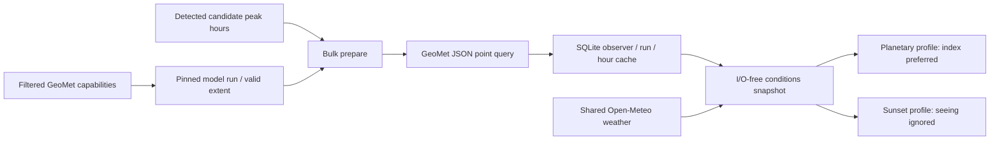

# Canadian seeing acquisition

Implemented 2026-10-07. We consume ECCC's RDPS astronomical seeing product, the
Canadian forecast underlying Clear Dark Sky's approach. We do not reproduce its
charts, scrape images or recompute the turbulence model. No third-party source
code was copied, no key is required, and existing Python dependencies suffice.

## Source and meaning

[ECCC's seeing explanation](https://www.canada.ca/en/environment-climate-change/services/weather-general-tools-resources/astronomy/seeing-forecast.html)
describes a zenith forecast based on cloud, weighted wind shear, boundary-layer
momentum flux and surface temperature trend. Native indices are cloud masked (0),
very bad (1), poor (2), average (3), good (4), excellent (5). The forecast was
calibrated with 28/35 cm telescopes. For the configured 203.2 mm reflector, we
preserve these categories and assess target altitude separately. Local terrain,
thermal equilibration, collimation and tube/ground turbulence remain unmodeled.
The source's approximate category interpretations are not converted into precise
arcsecond forecasts or an assertion that detail will resolve.

[RDPS open-data documentation](https://eccc-msc.github.io/open-data/msc-data/nwp_rdps/readme_rdps-datamart_en/)
describes the 10 km grid, four daily runs (00/06/12/18 UTC), and hourly forecast
steps up to 84h. Grid coverage is regional, including North America and part of
Northern Europe. The actually available time extent is discovered, not assumed.
Cloud-masked values stay unknown even when Open-Meteo predicts clear skies: these
models can disagree and a masked field contains no usable turbulence assessment.

Data attribution is **Environment and Climate Change Canada**, under its current
[Data Services End-use Licence](https://eccc-msc.github.io/open-data/licence/readme_en/)
(version 2.1.1, August 2026). The UI links the licence; email retains attribution.
Our suitability mapping and event scores are independent heuristic interpretations,
with no claim of ECCC endorsement.

## Acquisition and cache contract

[GeoMet WMS documentation](https://eccc-msc.github.io/open-data/msc-geomet/wms_en/)
supports filtered `GetCapabilities` and JSON `GetFeatureInfo`. We use the
`RDPS_10km_SeeingIndex` layer at the fixed HTTPS GeoMet endpoint. Queries pin
`TIME` and `DIM_REFERENCE_TIME`; the server must return those exact values.
Forecast time rounds to the nearest available hour, at most 30 minutes away.
We do not interpolate categories or extrapolate beyond the run's available extent.

EPSG:4326 in WMS 1.3 uses latitude/longitude BBOX order. A 101x101 pixel query
canvas centers the observer at I=J=50. Initial live tests with a tiny 3x3 canvas
returned a grid point over 100 km away; the current canvas returned nearby points.
We independently verify returned coordinates with a spherical distance and reject
points beyond `max_grid_distance_km` (default 25 km). This is a safeguard, not a
claim that the forecast resolves the local observing site to 25 km.

Profiles declare optional `required_metrics`; only peaks whose profile requests
`seeing_index` trigger seeing acquisition. Sunset-only hours are not downloaded.
Capabilities are cached for an hour by default. Point values are immutable
per run/hour/location and reused between events, cycles and restarts. Metadata
stale fallback is bounded to six hours; run age independently must not exceed
18 hours. Point acquisition has a 30-second budget, at most 32 HTTP queries per
cycle and an 8-second timeout per request (one final request can exceed the budget
by its timeout). Cache reads remain available after the budget. Failures back off
persistently, honor Retry-After and do not persist remote bodies/URLs. A point
HTTP/network failure backs off other point requests too. Partial failures preserve
usable hours. Small bounded responses, XML declaration rejection, numeric category,
coordinate, time and run validation treat external data as untrusted. Point caches
older than seven days are pruned independently of event history.

`ConditionsService` composes raw weather and supplementary seeing without changing
detectors. Metrics persist individual source freshness, model issue time, valid
time and retrieval time; provenance includes grid position/distance and method.
Planetary precedence is optional physical `seeing_arcsec`, native `seeing_index`,
then the labeled wind fallback. Index 0 blocks substitution. For scoring only,
indices 1–5 map linearly to 0–100 suitability; this ordinal heuristic is not a
calibrated probability, turbulence strength or resolution. Intrinsic interest
is unaffected. A stale selected seeing input sets `usable_for_alerts=false`, even
if a user sets minimum confidence to zero. Exceptional-interest alerts retain
their bypass. Sunset quality uses cloud layers and ignores seeing freshness.

## Verification and next improvement

Offline tests cover WMS axis/time contracts, all indices, grid-distance and
malformed-response rejection, sharing/restart, source outage and persistent 429
backoff, partial failure, model changes, run-age/extent limits, scoring precedence,
cloud masking, event revisions, notification deduplication and HTML/JSON/email
provenance. No live mail is sent. A separate live integration check used a private
test database and disabled delivery: 20 calculated predictions, nine carrying native
seeing from six shared hourly point queries, successful HTML pages, and zero
requests on the second cycle. Peaks beyond the available RDPS horizon used the
labeled wind fallback.

The current event assessment samples seeing near peak altitude, not an optimized
seeing window across the whole night. Next: compare forecasts with logged visual
or imaging observations on the 8-inch reflector before tuning weights or adding
window optimization. Transparency is still a visibility/humidity proxy; Canadian
transparency and other atmospheric products should only be acquired when a
profile and tests establish their interpretation.
