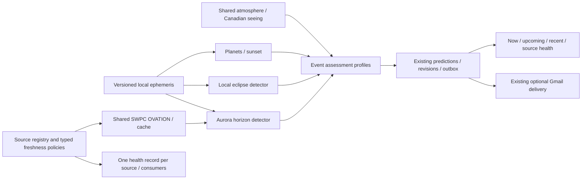

# Phase 2 design and implementation plan

Recorded after the baseline inspection and source research, before product changes,
2026-10-08. Baseline: **84 offline tests pass**, one existing TestClient warning.
Directory is not a git checkout. Existing normalized candidates, separate interest/
quality, SQLite outbox, Gmail adapter, weather/seeing acquisition and HTML are kept.

## Selected order and boundaries

Implement **observer-local solar/lunar eclipses** and **OVATION aurora horizon
opportunities** deeply. They exercise complementary long-range local ephemerides
and rapidly changing forecasts while sharing location, Sun/Moon calculations,
weather, persistence, policy and UI. Astronomy Engine already supports eclipses;
no Horizons dependency or replacement engine is justified for these consumers.
OVATION's public grid is operational and has actual upstream timestamps. An orbit
abstraction with no implemented orbit consumer is deliberately deferred.

First extend shared source health/freshness; then versioned/cached ephemeris
capabilities and eclipse calculations; then SWPC/aurora; then cadence/Now UI and
failure tests. The [source matrix](source-capabilities.md) covers all nine families.

Source registrations own their defaults/validators and construct shared provider
services. Detector registrations declare named dependencies, lane and calculation
cadence. Factories receive prepared services; detector code never performs HTTP,
weather downloads or notification delivery. Adding a normal source/detector means
one explicit registration plus its implementation/profile/config fixtures, not a
new branch in the coordinator. Existing weather remains its working common path;
the registry does not force a rewrite of its weather/seeing assembly.

Profiles declare their atmospheric acquisition needs and own freshness/expiry for
inputs they actually use. Policy respects Assessment.usable_for_alerts rather than
universally requiring weather. Service never adds a weather expiry to a profile
that ignores weather. A future observed event can score from its observation
geometry with atmosphere unknown. Registrations can opt out of local ephemeris
health dependencies; unrelated source health must not claim that consumer.

## Freshness and persistence

Add a normalized source-health record alongside existing component diagnostics
(additive SQLite migration). Record kind, retrieval, data/issue time, valid extent,
expected cadence, next refresh, age/stale/invalid thresholds, cached use, safe error
and affected detector names. Freshness is a policy on **source timestamps**, not
HTTP reachability. No upstream issue time is invented for Open-Meteo; Canadian
seeing retains run timestamps. Local ephemeris health reports library version and
calculation limitations, without fake observation age. UI reads can recompute age
and expiry so a stalled worker cannot leave a live source looking healthy forever.

Persist successful detector batches under observer/settings/engine-version/horizon
cache keys to avoid recomputing slow geometry on every weather refresh/restart.
Reassess cached future candidates against updated atmosphere and current alert
policy. A failed refresh must not withdraw an old prediction or reset deduplication.
Catalog/orbit support later reuses the same source policy with source-specific
epochs and validity; no arbitrary universal TTL will be applied.

## Scheduling and temporal semantics

Keep one process/OS lock and SQLite transactional writes. Two independently paced
in-process work lanes (slow astronomy and live forecasts), plus bounded delivery,
prevent a slow catalogue/geometry job or email from blocking live detections.
Each lane is serial and never overlaps itself; SQLite creates a connection per
operation, HTTP clients support concurrent use, and shared weather publishes an
atomic snapshot. Source TTL/backoff remains independent of detector cadence.
The slow lane owns weather acquisition; live profiles read the latest shared
snapshot and fail closed until it is ready. No distributed scheduler is needed.

Explicit CLI `evaluate` still evaluates all enabled detectors once. Background
work reuses batches within per-detector computation cadence; forecasts/policy are
reassessed on evaluation cycles. Restart caches are validated and keyed by settings.
Long-range eclipse horizon is detector-specific rather than making planetary
night sampling span years. The live lane period derives from actual enabled
detectors; no polling of unused sources.

Within the live lane, each detector has its own due time; adding a 15-second
aircraft consumer cannot force a 5-minute aurora consumer to recompute every 15
seconds. Live due times reset at restart, then recompute immediately from the
validated persistent source cache. Live candidates themselves are not reused from
durable batch caches. SWPC serializes refreshes and atomically publishes its frame
so shared consumers do not race identical requests.

Add only one envelope distinction needed now: scheduled/opportunity/transient
temporal kind. A transient's current qualified state can reach a deduplicated
`active` milestone, while scheduled events retain the existing no-belated-email
rule. Aurora identities use observer + local observing night, not every moving
forecast timestamp. Revisions preserve the evolving model; milestones stay unique.
Future aircraft identities will use ICAO/track episode with a disappearance gap,
not callsign alone. Aircraft is not claimed as implemented by this convention.

## Scientific contracts and graceful degradation

Eclipses: local solar type/contacts/obscuration and lunar phases; clip to visible
intervals with local altitude searches, record whether maximum is visible and
contacts below horizon, show solar-viewing safety. Global totality below the
observer horizon must not be advertised as local visible totality. Intrinsic
interest remains independent of clouds; exceptional events keep policy bypass.
Searches are local, cached, and do not manufacture old predictions on startup.

Aurora: validate the full geographic OVATION grid and its observation/forecast
timestamps. Project active cells onto observer bearings/elevations using a
spherical Earth and explicit uncertain emitting-height range. Score horizon,
darkness, cloud/transparency and Moon independently. Classify opportunity bands
as heuristic, never calibrated visual probability. No Kp-only map; missing/stale
OVATION disables qualifying aurora predictions. Grid-scale cloud is a shared
point proxy; directional/horizon screening remains unavailable and must be stated.
No extra Kp/Bz calls until the detector consumes their explanatory information.

Scientific input validity belongs to Candidate.valid_until, separately from the
Assessment validity of atmosphere/seeing. OVATION is the concrete consumer of this
distinction. Exceptional importance may bypass poor/unknown weather but cannot
bypass expired prediction inputs, including queued watch delivery. This avoids
misusing the weather bypass for future stale orbital/live-observation predictions.
Past envelopes default to no scientific expiry; static local ephemerides do not
receive arbitrary observation TTLs.

## Extension review and deferred scope

Noctilucent clouds can consume shared profiles/local Sun geometry with their own
profile; fireballs can use the live lane/observation age policy; weather balloons
can use track-episode geometry; satellite flares need the future orbit service and
attitude/reflectance data. None should alter Gmail, storage or unrelated detectors.
Do not force live observations through eclipse cadence or ephemeris through an
observation-age check.

Deferred families and acceptance gates are documented in the matrix and final
implementation report: ADS-B requires track episodes/rules/licensing; optics a
small validated GRIB-profile consumer; ISS precise OMM/SGP4/timing validation;
spaceflight published trajectories/optional account; Jupiter contact geometry and
dated GRS; occultations limb geometry and independent contacts; comets orbit and
brightness uncertainty. No placeholder source/detector files will be created.
