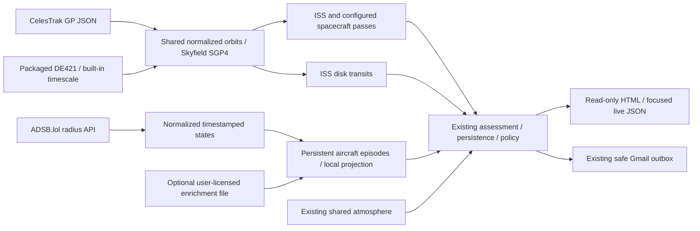

# Phase 3 design

Recorded 2026-10-09 before implementation. Baseline: 137 offline tests passed.
Keep the modular monolith, Candidate/Assessment separation, SQLite revision/outbox
contracts, existing source health, atmosphere, Gmail and worker lanes.

## Concrete boundaries

- orbit provider acquires minimal per-catalog GP JSON no more often than two hours,
  validates OMM fields and frames, persists cache and any HTTP stop latch. Epoch,
  retrieval, warning/stale/invalid gates are distinct. A public source adapter is
  replaceable without changing geometry. Space-Track adds no necessary capability
  to these consumers and remains optional future work, with account terms reviewed
  before integration.
- Orbital geometry is local and I/O-free. Skyfield/sgp4 (MIT dependencies) use
  WGS72 SGP4, WGS84 observer, explicit UTC input, built-in TT/UT1/leap tables and
  packaged DE421 (1900–2053). No service-time kernel download. Passes use geometric
  horizontal positions and Earth-shadow geometry. Transit refinement uses apparent
  observer vectors for both satellite and body, including light time/aberration.
- Orbit age gates apply both at evaluation and target time. Routine passes use
  warning 24h, stale 48h, invalid 96h defaults; transits require element age <=12h
  now and <=24h at target. These are conservative application gates, not measured
  accuracy or covariance. Numerical millisecond roots cannot establish real
  millisecond timing; nominal transits remain explicitly experimental.
- Satellite detectors run in the slow lane, caching geometry by element identity
  as well as settings. The delivery loop reevaluates milestones from persisted
  candidates every 15 seconds without propagation or downloads. Event identity
  is catalog + revolution/pass occurrence, independent of refreshed contacts.
- Aircraft provider owns HTTP, position timestamps, bounded payloads, cache and
  backoff. Detector receives prepared snapshots and an injected episode repository.
  Schema 3 adds a small track-episode table; no changes to old prediction/alert keys.
  ICAO plus persisted episode start gives restart-stable identity. Absence/hysteresis
  preserves identity during brief gaps; actual position expiry immediately prevents
  current claims and alerts. Episode continuity is not scientific validity.
- Short projection uses local WGS84 ENU velocity, bounded to a few minutes. Sky
  motion comes from observer-relative vectors, not a route or compass heading.
  Geometric altitude is preferred; barometric altitude is disclosed as approximate.
  Existence and aircraft policy do not depend on weather; optional weather is prose.
- Enrichment is a separately refreshed, much longer cached catalog with provenance,
  source/update/expiry; missing, malformed or expired entries are non-gating. No
  third-party route dataset is incorporated without permission. With no licensed
  input, routes remain unknown. Position provider type codes retain attribution.
  It is declared as an optional provider dependency; unexpected refresh or snapshot
  failures cannot block tracking. Required source failures remain detector-isolated.
- The existing live due-time mechanism handles 15s aircraft and 300s aurora
  independently. Weather/GP are not fetched at aircraft cadence. A small external
  script polls focused live JSON every 15s and uses textContent only. Normal HTTP
  requests still initiate no acquisition or calculations.

## Claim boundaries and validation plan

Support real visible ISS/configured catalog-object passes, persistent ADS-B
overhead/approaching episodes, and nominal ISS center-track Sun/Moon disk transit
contacts. Do not infer magnitude, route, a launch plume or reentry from a schedule.
Center-track contacts exclude ISS silhouette/attitude, terrain and limb topography.
Solar safety reuses the eclipse text in UI and email. Moon transits exist in daylight.

Freeze OMM and aircraft provider payloads. Verify SGP4 against Vallado published
TEME vectors (position 1e-5 km, velocity 1e-8 km/s). Validate observer geometry
against an independent TEME/GMST/WGS84 calculation (0.02 degree, 1 km; UT1/frame
differences explicit). Validate transit contacts on frozen physical orbital cases
using independent Astronomy Engine body directions, direct SGP4 and separate root
calculation: contact difference <=0.1s, separation <=0.02 degree. These validate
algorithms on fixed inputs, not actual future transit accuracy. Synthetic grazing,
miss and subsecond fixtures additionally verify numerical roots to 0.002s.

Tests cover fresh/stale inputs, HTTP errors/backoff/stop latch, shared cache,
episode gaps/end/restart/dedup, enrichment failure, additive migration, cheap
milestones, serialization/escaping, DST, source aging and existing regression suite.
Explicit public connectivity smoke uses separate storage and no email/secrets.

## Spaceflight and deferred decisions

Configured NORAD IDs can use exactly the pass geometry once first elements are
available. Launch Library 2 schedules and CelesTrak DECAYING/Space-Track TIP were
evaluated, but do not establish a local visible trajectory or plume. Retain their
documented source capabilities/backlog rather than creating unused API adapters.
No reliable general structured venting/fuel-dump feed established. Authenticated
Space-Track, automatic discovery of new catalog objects, uncertainty footprints,
validated brightness, live commercial route enrichment, and geographic reentry
prediction remain deferred. Ice optics, Jovian/GRS, occultations and comets are
explicitly outside Phase 3. No runtime LLM or agent orchestration.
