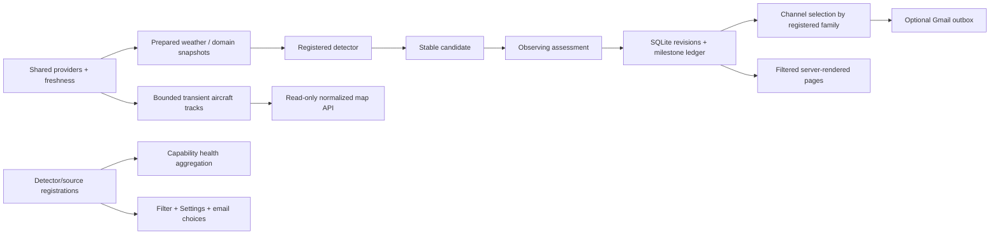

# LAN, mobile and atmospheric-optics extension

Design recorded 2026-10-10 before implementation. Baseline: 180 offline tests pass.
The actual configuration already enables ISS/transits/ADS-B and has Gmail disabled.
There is no existing ice-optics or HRRR implementation and no git checkout.

Keep the modular monolith and existing event/outbox contracts. Extend concrete
registrations with display labels; detector IDs supply filter and Gmail categories.
No detector knows delivery channels. Gmail's `event_types=["*"]` preserves existing
all-types behavior; an explicit list excludes future categories. Local milestones
are always recorded; adapters are selected only when a new milestone is inserted.
Disallowed pending mail is canceled; changing selection never backfills old alerts.

Network configuration belongs to service settings: explicit bind/port/LAN policy,
exact allowed hosts and explicit trusted proxy IPs. Default remains localhost.
LAN mode accepts loopback/RFC1918/IPv6 ULA/link-local clients, not public clients.
Forwarded headers are disabled unless explicit proxy IPs are configured. Host
validation remains independent. No router/public exposure or firewall changes.

Settings use a fixed operational-field allowlist, JSON POST, bounded request body,
signed double-submit CSRF token, exact same-origin check and optimistic config
revision. TOML Kit preserves comments/unrelated settings; the existing schema
validates the whole resulting document before fsync and atomic replace. No secrets,
observer or arbitrary paths in editable JSON. Saves explicitly require restart;
runtime continues with its immutable startup configuration. A config-sync CLI adds
missing defaults while preserving supplied values; it never enables omitted modules
implicitly. This development update explicitly enables the new coarse optics module.

Aggregate health derives enabled capabilities from required/optional registration
contracts and shared atmospheric profile needs. Missing required live data is red;
stale/degraded data and enabled optional losses/fallback are yellow; initialization
is gray; intentionally disabled optional providers are ignored. Worker errors are
material, ephemerides use coverage/version rather than a live TTL. Explain affected
capabilities and keep detailed source views. Database read failures return red/503.

ADSB.lol remains one server-side source. A thread-safe bounded track buffer retains
fresh observed positions independently of interesting event episodes; no per-map
HTTP or prediction writes. Retention/time/count bounds and privacy/freshness gates
apply. The map reads a bounded normalized snapshot, optional prepared enrichment
and local short projections. Solid observed breadcrumbs and dashed constant-motion
continuations are distinct. Restart clears trails, not durable alert identities.
Leaflet 1.9.4 is self-hosted with its BSD-2-Clause notice: a justified reuse of a
standard map library, not a copied detector architecture. OSM tiles are optional,
human-viewed only, attributed, normally browser-cached with an origin Referer.
Blank-map mode supports offline/automated layout checks without tile requests.

Sky-crystal detection receives the already refreshed shared conditions snapshot.
Open-Meteo adds surface temperature/dewpoint to the combined request. Hourly local
Sun/Moon geometry screens 22-degree halos, parhelia, CZA, tangent arcs, low-elevation
pillars and separate near-surface diamond-dust opportunities. Interest, geometric
possibility, crystal suitability and foreground cloud obstruction stay separate;
all scores are coarse uncalibrated opportunities with orientation/habit unknown.
Identity is phenomenon/body/local-day; reevaluations update a single window.

Optional HRRR enrichment uses official NOAA natural-level indexes and strict HTTP
byte ranges for selected fields/levels, never entire GRIB files. ecCodes is an
optional portable decoder; acquisition is size/request bounded, persistent,
run/forecast/observer-keyed and backed off. Model issue, valid and retrieval times
are distinct. Sparse sampled layers are not a complete vertical profile. Missing
microphysics/unsupported locations/decoder failures use the coarse model, not a
universal detector failure. Crystal habit/orientation/optical depth remain unknown.
Default/example HRRR is disabled to avoid surprising continuous GRIB bandwidth.
After a successful Windows range/decode probe and run-cache verification, actual
development config explicitly enables it with the bounded defaults (~25 MB/run).

HTML/Jinja evolves with responsive navigation, touch controls, reflowing tables,
registry checkboxes and URL filter state. Settings/map pages avoid timed full-page
reload; lightweight polling updates aircraft/health. Ordinary UI reads trigger no
external data acquisition. No SPA, runtime LLM, broker, config hot-reload framework
or unbounded ADS-B history.

## Extension review

New detector registration supplies label, dependencies, optional dependencies,
profiles, lane and defaults; filter/enable/email choices derive from it automatically.
The generic event envelope/outbox need no family-specific delivery code. Detailed
SourceHealth remains the common freshness contract; source registration adds an
explicit health-name prefix for aggregation. A profile declares consumed metrics
so weather loss never vetoes pure aircraft/orbit existence. New configuration
defaults flow through validated `config-sync`, with enablement deliberately explicit.

The map remains separate from persistent notifiable aircraft episodes. Its in-memory
lock/count/time bounds permit fast updates independent of slower astronomical lanes.
Health/config controls do not cause upstream acquisition. Settings protects core
configuration and uses restart rather than a source-reload framework. Primary
deployment is now native Raspberry Pi OS/Trixie; Synology/Docker is deprecated
and unmaintained. See [Pi operation](raspberry-pi.md) and [camera design](camera-architecture.md).

Deferred: authentication inside the app, full vertical profiles, directional cloud
screening, a calibrated optical opportunity model, crystal habit/orientation,
additional lunar/artificial-light pillar geometry, full track history persistence,
new routed event-kind hierarchy, dynamic plugins and runtime hot reload. Current
eight-family controls wrap on phones; larger registries may benefit from searchable
groups without changing detector or routing contracts. Config revision guards are
optimistic and single-service scoped; CLI/manual maintenance requires stopping the
service. No cross-process transactional editor was introduced.
